# EnergyLIB user guide

For version `0.8.43.dev1` and EnergyLIB inverters connected through a data logger.
[中文使用手册](USER_GUIDE.zh-Hans.md)

The pages follow Home Assistant's language. Entity names use the system language
(**Settings → System → General**); cards and the digital twin use each user's
profile language. English and Simplified Chinese are included.

## 1. Install

1. Open **HACS**, then **⋮ → Custom repositories**.

   

2. Enter `https://github.com/zhiliangxiaoying/HA-EnergyLib`, choose type **Integration**, then **ADD**.

   

3. Search HACS for **EnergyLIB** and download it.
4. Restart Home Assistant.

## 2. Add the device

**Automatic**: when your network has only one EnergyLIB inverter, it is added by itself about a minute after installation, and its data is shown. To control it (EMS mode, power on/off, battery settings), open **Settings → Repairs**, choose “Is this your inverter?” and **Submit**.

**Discovered**: with several inverters, or after you removed one, go to **Settings → Devices & services**, find **EnergyLIB**
under *Discovered*, select **Add**, then **Submit**. The port and other details are filled in.

**Manually**: select **Add integration** and search for **EnergyLIB**.

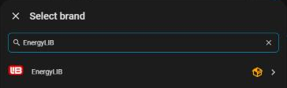

Enter the logger's IP address, its port and the unit ID (usually 1), then **Submit**.

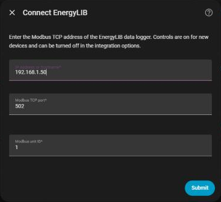

The integration page then shows your device:

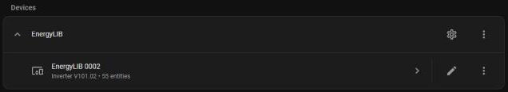

## 3. Open the dashboard

**EnergyLIB** appears in the sidebar by itself once the inverter is added; open it for the overview, and switch to **Digital twin** at the top.

If it does not appear (for example because you added an EnergyLIB dashboard yourself earlier), add it by hand:

1. Go to **Settings → Dashboards** and select **Add dashboard**.
2. Under **Community dashboards**, choose **EnergyLIB**.

   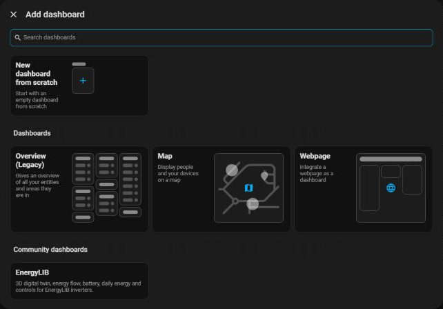

3. Enter a title and URL, for example `EnergyLIB` and `energylib-home`, tick
   **Show in sidebar**, then **Create**.

**EnergyLIB** now appears in the sidebar. The tabs at the top switch between the
overview and the **Digital twin**.

No EnergyLIB option? Check that the integration is installed and added, then reload
the browser. Right after installing or updating, restart Home Assistant if it is still missing.

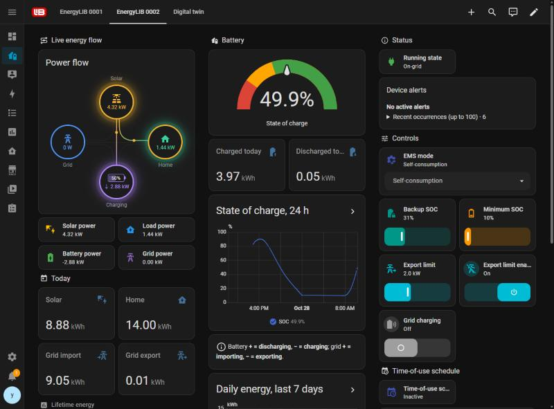

## 4. Read the power flow

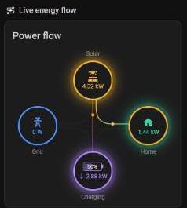

- Dots move along a line from where power comes from to where it goes; faster dots mean
  more power. Circles with power glow.
- **Grid**: → importing, ← exporting. **Battery**: ↓ charging, ↑ discharging; the
  percentage is the state of charge.
- The home ring shows where your power comes from: yellow = PV, purple = battery,
  blue = grid. All yellow means everything comes from PV.

When the grid is down (off-grid) or no battery is connected, that circle turns grey with a red ✕:

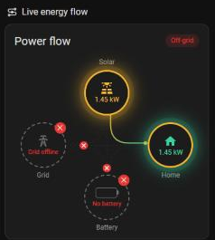

## 5. Digital twin

Select **Digital twin** at the top to see PV, battery, grid and home use on a 3D house.
The buttons at the bottom change the view.

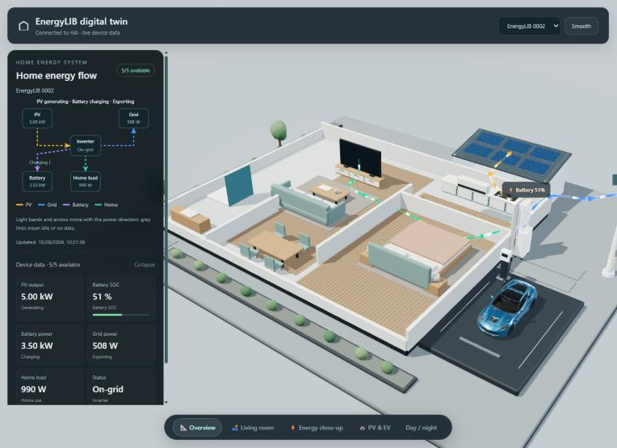

## 6. Alerts

The **Device alerts** card lists current faults, warnings and notices. Open
**Recent occurrences** for the history.

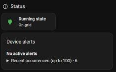

## 7. Control access (on by default)

New devices have control turned on, so **Controls** appears on the overview. To stop
Home Assistant from changing device settings:

1. Go to **Settings → Devices & services → EnergyLIB** and select the ⚙ gear on the **EnergyLIB** row.
2. Choose **Control access**.

   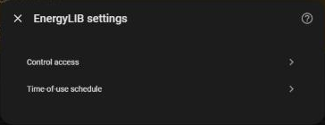

3. Untick **Allow control** and **Submit** (tick it again when needed).

   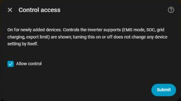

## 8. EMS mode and settings

With control on, **Controls** appears on the right of the overview. Changes are written
to the device and read back to confirm.

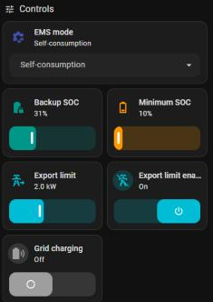

| EMS mode | In one sentence |
|---|---|
| Self-consumption | Everyday choice: PV powers the home first, then charges the battery, then exports |
| Time-of-use | Charges or discharges in the periods from section 9; suits peak/off-peak tariffs |
| Backup | Keeps the battery full (charging from the grid if needed); use before an outage |
| PV charge priority | PV charges the battery first; the home runs from the grid; the grid never charges the battery |
| Feed-in priority | PV powers the home first, exports the surplus, and charges the battery last |

| Setting | What it does |
|---|---|
| Backup SOC | Discharge stops here, keeping a reserve for outages |
| Minimum SOC | Lowest battery level |
| Grid charging | When off, the grid never charges the battery |
| Inverter power | Tap the icon and confirm to switch on or off; when off, PV and the battery stop, and without the grid the home loses power |
| EMS | The same setting as "EMS mode", with the modes as words, for Apple Home and Siri (for example "Turn on Self consumption") |
| Export limit + Export limit enabled | Caps how much power is exported; set both |

## 9. Time-of-use schedule

1. In the **Time-of-use schedule** section select **Edit schedule**, then the ⚙ gear on the
   **EnergyLIB** row → **Time-of-use schedule**.

   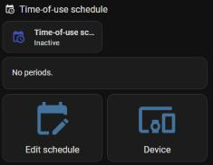

2. Select **Add period**.

   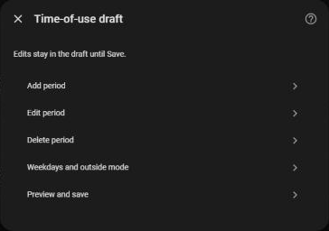

3. Choose **Charge** or **Discharge**, enter the start, end and power, then **Submit**.

   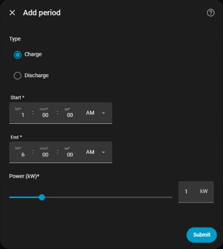

4. Back in the menu, select **Preview and save**. To apply it now, tick
   **Switch to time-of-use after saving**.

Note: a period cannot cross midnight (split 23:00–01:00 into two periods).

## 10. Forced battery charge / discharge (temporary)

Charge or discharge the battery at a set power for a while; the previous mode returns afterwards.

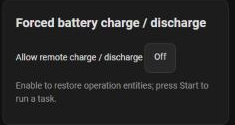

1. Turn on **Allow remote charge / discharge** and wait about 30 seconds for the card to load.
2. Choose **Charge** or **Discharge** and enter the power (kW) and duration (minutes).
3. Select **Start charging** or **Start discharging**; **Stop** ends it at any time.

Tip: discharge power is the inverter's total output (PV + battery), so with strong PV
the battery discharges less.

## 11. Energy dashboard (long-term statistics)

In **Settings → Dashboards → Energy**, pick these EnergyLIB totals:

| Energy dashboard item | Choose |
|---|---|
| Grid consumption | Grid import energy |
| Return to grid | Grid export energy |
| Solar production | Solar energy |
| Battery in / out | Battery charge energy / Battery discharge energy |

## 12. Troubleshooting

| Problem | What to do |
|---|---|
| Not discovered | Add it manually (section 2) |
| HACS shows "icon not available" | Some HACS versions still load icons from the old public brands repository; EnergyLIB ships its own icon, which HA uses after installation. See the [HACS issue](https://github.com/hacs/integration/issues/5402) |
| Old look after an update | Hard-reload the browser (Ctrl+Shift+R) |
| No Controls card | Check **Allow control** (section 7) |
| Want voltages, individual PV strings, etc. | Device page → **disabled entities**, enable what you need |
| Numbers differ from the vendor app | They refresh at different times (HA about every 10 s); compare again later |
| Names still in the old language | They follow the system language and update by themselves; for an offline device they change once it reconnects |

To report a problem: device page → ⋮ → **Download diagnostics**, and send it with a short description.
