# EnergyLIB 使用手册

适用版本 `0.8.43.dev1`，适用于 EnergyLIB 逆变器（经采集棒接入）。想了解更多细节，看 [进阶说明](USER_GUIDE_ADVANCED.zh-Hans.md)。[English user guide](USER_GUIDE.md)

界面语言跟随 Home Assistant：实体名称跟随系统语言（**设置 → 系统 → 常规**），卡片和数字孪生跟随每个用户自己的语言设置。目前包含简体中文和英文。

## 1. 安装

1. 打开 **HACS**，点右上角 **⋮ → Custom repositories（自定义存储库）**。

   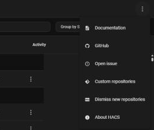

2. 填入 `https://github.com/zhiliangxiaoying/HA-EnergyLib`，Type 选 **Integration**，点 **ADD**。

   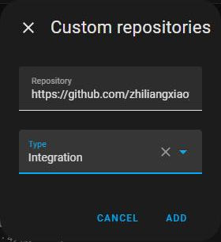

3. 在 HACS 里搜索 **EnergyLIB**，点击下载。
4. 重启 Home Assistant。

## 2. 添加设备

**自动发现（推荐）**：进入 **设置 → 设备与服务**，在"已发现"里找到 **EnergyLIB**，点 **添加** → **提交**，端口等信息会自动填好。

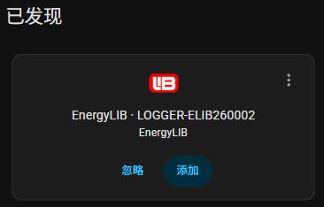

**手动添加**：没有自动发现时，点右下角 **添加集成**，搜索 **EnergyLIB**。

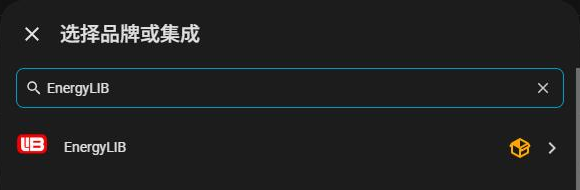

填采集棒的 IP 地址、端口（采集棒实际使用的端口）和设备地址（通常为 1），点 **提交**。

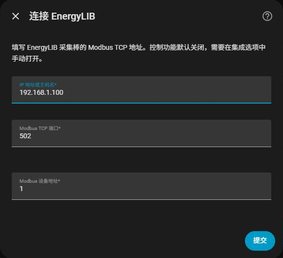

添加完成后会看到 1 个设备：

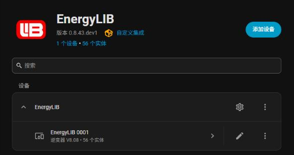

## 3. 打开总览

1. 进入 **设置 → 仪表盘**，点击右下角 **添加仪表盘**。
2. 在 **社区仪表盘** 中选择 **EnergyLIB**。

   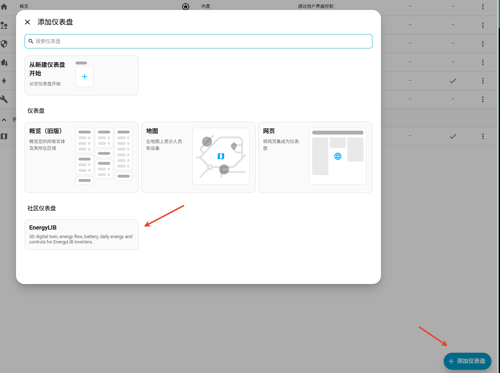

3. 填写标题和网址，例如标题 `EnergyLIB`、网址 `energylib-home`，勾选 **添加到侧边栏**，然后点击 **创建**。

创建后，左侧会出现 **EnergyLIB**，进入后可以在顶部切换 **总览** 和 **数字孪生**。

如果没有看到 EnergyLIB 选项，先确认已经安装并添加集成，然后刷新浏览器页面；刚安装或更新插件时，如果刷新后仍没有出现，请重启 Home Assistant，再刷新页面查看。

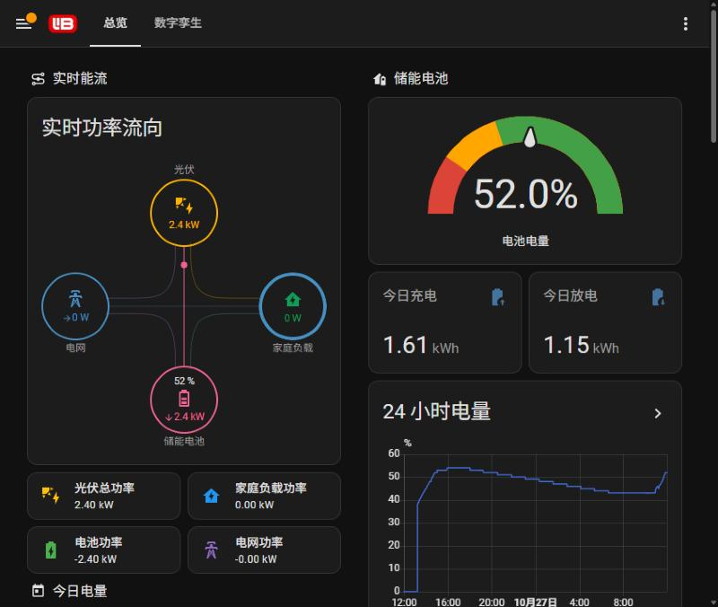

## 4. 看懂能量流

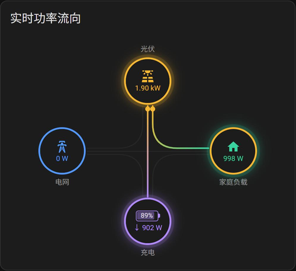

- 线上的圆点表示电从哪里流向哪里，功率越大圆点越快；有功率的圆圈会发光。
- **电网**：→ 买电，← 卖电。**电池**：↓ 充电，↑ 放电，下面的百分比是电池电量。
- 家庭圆环的颜色表示家里的电来自哪里：黄 = 光伏，紫 = 电池，蓝 = 电网；全部来自光伏时整圈是黄色。

电网断开（离网运行）或电池未接入时，对应圆圈变灰并显示红色 ✕：

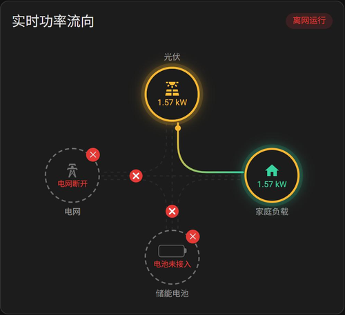

## 5. 数字孪生

点击页面顶部的 **数字孪生**，用 3D 房屋看光伏、电池、电网和家里的用电。底部按钮可以切换视角。

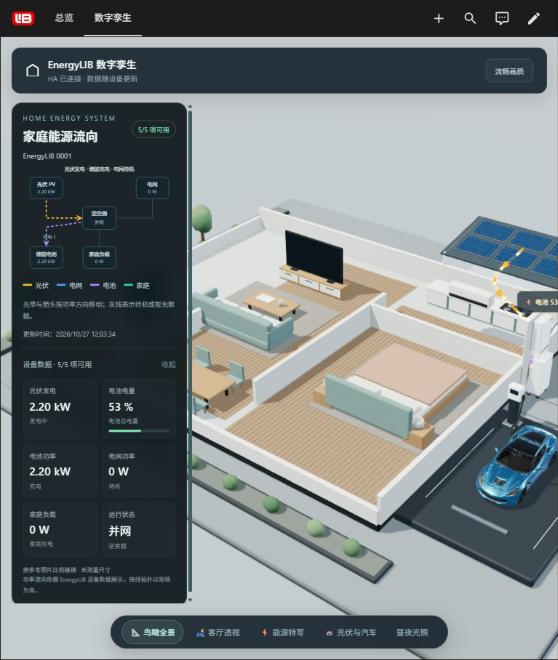

## 6. 查看告警

总览右侧的 **设备告警** 卡片会列出当前的故障、警告和提示，点 **最近记录** 可以看历史。

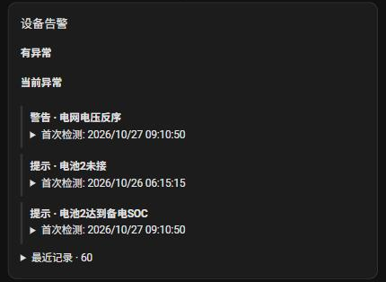

## 7. 控制权限（默认开启）

新添加的设备默认已开启控制，总览里会直接出现 **运行控制**。不想在 HA 里改设备参数时可以关闭：

1. 进入 **设置 → 设备与服务 → EnergyLIB**，点 **EnergyLIB** 那一行右边的 ⚙ 齿轮。
2. 选择 **控制权限**。

   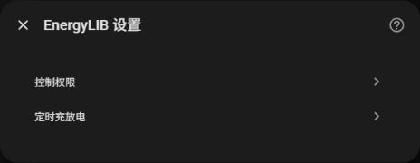

3. 取消勾选 **允许控制**，点 **提交**（需要时再勾选回来）。

   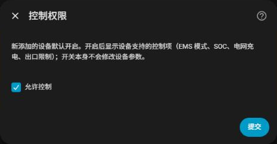

## 8. 切换 EMS 模式、调整参数

开启控制后，总览右侧出现 **运行控制**。修改后会写入设备并读回确认。

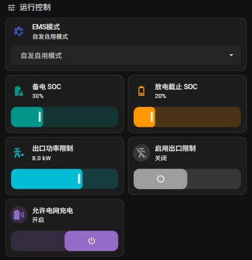

| EMS 模式 | 一句话说明 |
|---|---|
| 自发自用模式 | 日常推荐：光伏先给家里用，多的充电池，再多的卖电 |
| 定时充放电模式 | 按第 9 节设置的时段充电或放电，适合峰谷电价 |
| 备电模式 | 一直把电池充满（会用电网充），适合停电前 |
| 光伏优先充电 | 光伏先充电池，家里用电走电网，不用电网充电池 |
| 卖电优先模式 | 光伏先给家里用，多的先卖电，最后才充电池 |

| 参数 | 作用 |
|---|---|
| 备电 SOC | 电池放到这里就停，留作停电备用 |
| 放电截止 SOC | 电池最低电量 |
| 允许电网充电 | 关闭后，电网不会给电池充电 |
| 逆变器开关机 | 点图标确认后开机或关机；关机后光伏和电池停止工作，没有电网时家里会断电 |
| 出口功率限制 + 启用出口限制 | 限制最多卖多少电；两项都要设置 |

## 9. 定时充放电

1. 在总览的 **定时充放电** 区点 **编辑定时计划**，再点 **EnergyLIB** 那一行的 ⚙ 齿轮 → **定时充放电**。

   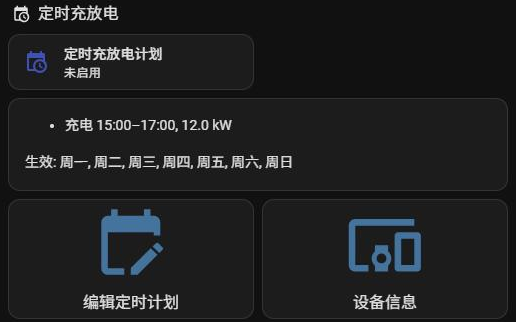

2. 点 **添加时段**。

   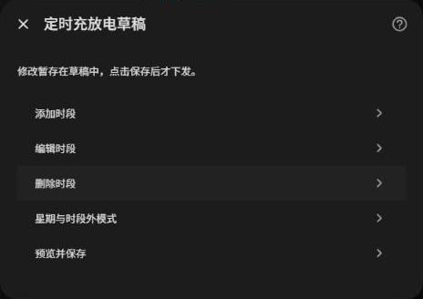

3. 选 **充电** 或 **放电**，填开始、结束时间和功率，点 **提交**。

   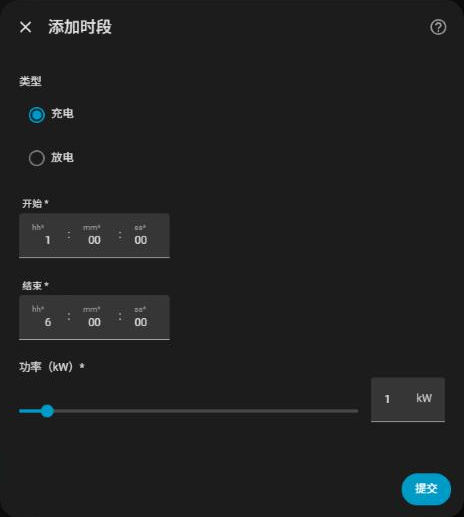

4. 回到菜单点 **预览并保存**；要马上生效就勾选 **保存后切换为定时充放电**。

注意：时段不能跨零点（例如 23:00～次日 01:00 要拆成两段）。

## 10. 电池强制充放电（临时）

临时让电池按指定功率充电或放电一段时间，到时间自动恢复原来的模式。

1. 打开 **允许远程充放电**，等约 30 秒卡片加载完。
2. 选择 **充电** 或 **放电**，填功率（kW）和时长（分钟）。
3. 点 **开始充电** 或 **开始放电**；随时可以点 **立即停止**。

提示：放电功率指逆变器总输出（光伏 + 电池），光伏大时电池放得少。

## 11. 能源面板（长期统计）

进入 **设置 → 仪表盘 → 能源**，按下表选择 EnergyLIB 的累计电量：

| 能源面板项目 | 选择 |
|---|---|
| 电网购电 | 累计购电量 |
| 返回电网 | 累计上网电量 |
| 太阳能发电 | 累计光伏发电量 |
| 电池充入 / 放出 | 累计电池充电量 / 累计电池放电量 |

## 12. 常见问题

| 问题 | 怎么办 |
|---|---|
| 找不到自动发现 | 用第 2 节的手动添加 |
| HACS 列表显示“图标不可用” | 部分 HACS 版本仍从旧公共品牌库取图；EnergyLIB 已包含本地图标，安装后 HA 可以使用。参见 [HACS 相关问题](https://github.com/hacs/integration/issues/5402) |
| 升级后页面还是旧样式 | 强制刷新浏览器（Ctrl+Shift+R） |
| 没有运行控制卡片 | 按第 7 节检查 **允许控制** 是否勾选 |
| 想看电压、各路光伏等数据 | 设备页 → **已禁用实体**，按需启用 |
| 和厂家 App 数字不一样 | 刷新时间不同（HA 约 10 秒一次），稍后再对比 |
| 改了语言后名称还是旧的 | 名称跟随系统语言自动更新；离线的设备要等重新连上后才更新 |

遇到问题需要反馈时：设备页 → ⋮ → **下载诊断信息**，连同问题描述一起发给我们。
